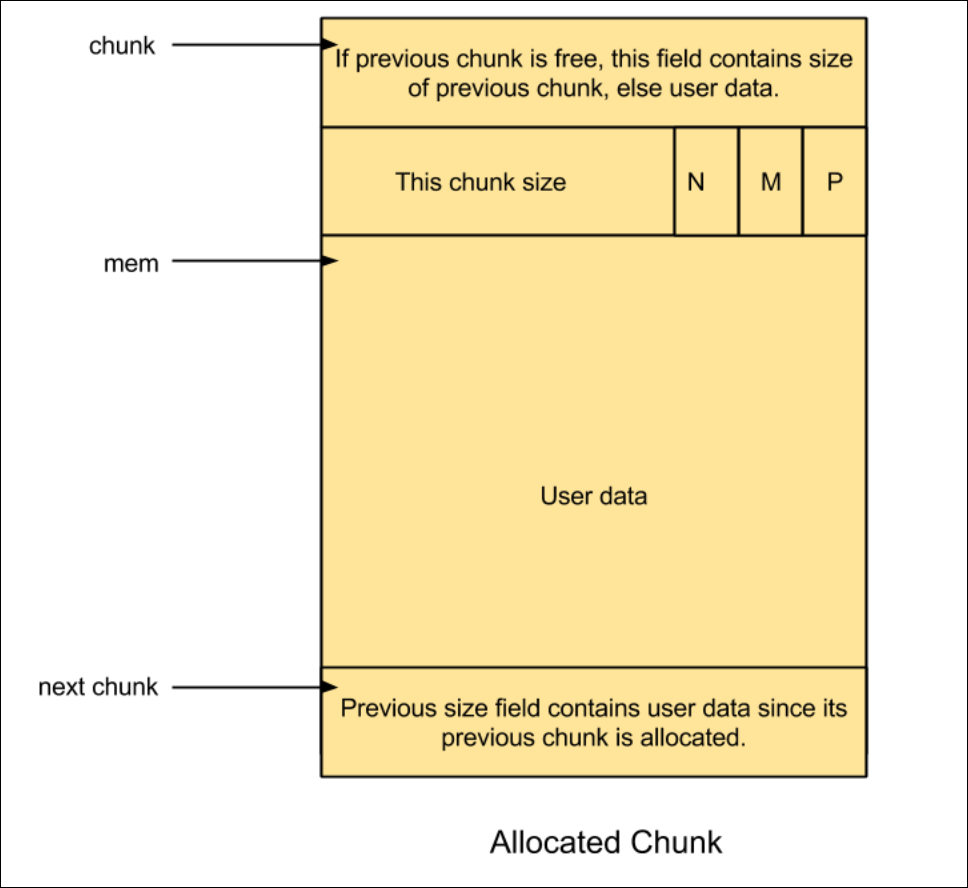
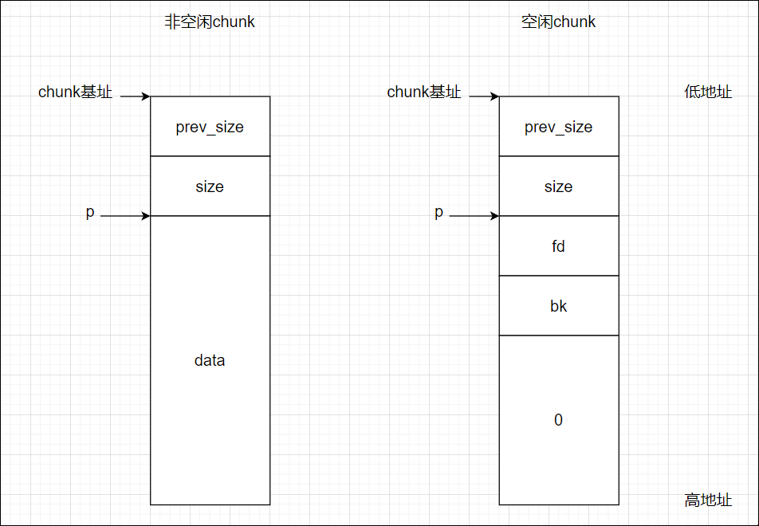

> 参考文章

[Glibc堆利用之house Of系列总结 | roderick - record and learn!](https://www.roderickchan.cn/zh-cn/2023-02-27-house-of-all-about-glibc-heap-exploitation/#1-%e5%89%8d%e8%a8%80)

[堆利用系列之house of spirit-安全KER - 安全资讯平台](https://www.anquanke.com/post/id/244158)

#### house of spirit

house of spirit攻击是一种构造虚假的chunk(通常是fast chunk)，free这个chunk把它放到fastbin上，然后通过再次申请得到对这个chunk的控制权。构造虚假chunk的时候需要注意两个size，一个是这个虚假chunk的size还有一个是紧邻chunk的size。在特殊的场景下可以进行应用。[堆利用系列之house of spirit-安全KER - 安全资讯平台](https://www.anquanke.com/post/id/244158)

我发现。我好像又把chunk结构搞忘了。

我贴点图好了。

嗯差不多

##### 例题

> oreo
> 
> 32
> 
> 2.24

溢出覆盖got表然后system('/bin/sh')

没有仔细看

睡一觉明天接着看

好饿

这题太老了好像libc库不太行吗总之
