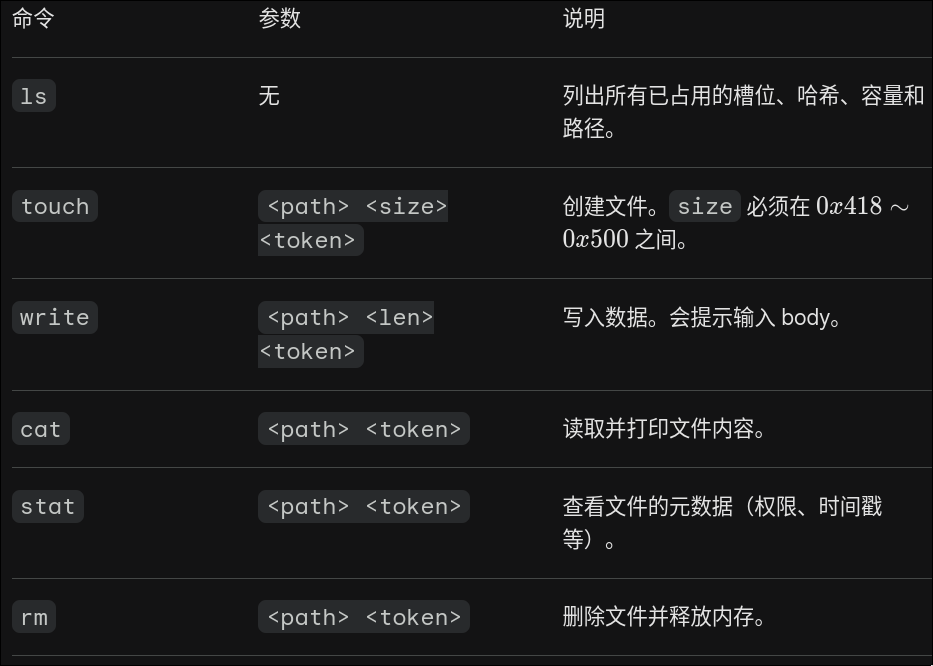

# su_mini_vfs

获得了一个1.6g的题目合集压缩包。第一眼看到此题。于是试图写一下。题目附赠的wp有三行。

## 题干阅读

好像要修一下结构体（？）

但是也能看（吗

好难看（dbq



# su_evbuffer

这道题见过（

唉

写吧

想办法调用mprotect然后写shellcode（

还需要让flag能够输出出来显示

```c
struct bufferevent {
    struct event_base *ev_base;
    const struct bufferevent_ops *be_ops;
    void *lock;

    struct event ev_read;   // 注意：这是一个嵌套的完整结构体，占空间很大
    struct event ev_write;  // 注意：嵌套结构体

    struct evbuffer *input;
    struct evbuffer *output; // <--- 【关键目标】这里存放着 output 缓冲区的指针

    struct event_watermark wm_read;
    struct event_watermark wm_write;

    bufferevent_data_cb readcb;
    bufferevent_data_cb writecb;
    bufferevent_event_cb errorcb;
    void *cbarg;

    struct timeval timeout_read;
    struct timeval timeout_write;
    short enabled;
};
```

结构体

有点痛苦我说。

其实也还好。
